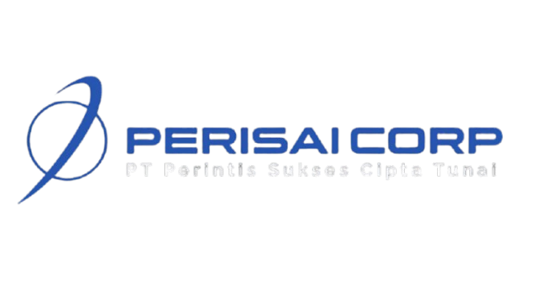

# PERISAI CORP — Integrated Defense & Technology Solutions

<p align="center">
  
</p>

<p align="center">
  <strong>Website Profil Perusahaan & Sistem Katalog Produk Industri Pertahanan Terpadu</strong>
</p>

<p align="center">
  
  
  
  
  
  
  
</p>

---

## 📌 1. Tentang Project

**PERISAI CORP** (*PT Perisai Corp Indonesia*) adalah aplikasi web berbasis **Laravel 12** modern yang dirancang sebagai platform **Company Profile** dan **Sistem Manajemen Katalog Produk** untuk holding industri pertahanan dan keamanan nasional.

Website ini menyajikan informasi lini bisnis strategis di bidang pertahanan militer, mulai dari manufaktur *tactical & armored bodywork*, perangkat optik tempur (*Night Vision & Thermal Optics*), hingga perangkat elektronika pertahanan dan komunikasi taktis.

Selain portal publik dengan estetika militer-taktis (*tactical dark mode UI*), website ini dilengkapi dengan **Panel Admin Terproteksi** yang mengizinkan tim internal mengelola kategori dan produk, lengkap dengan dukungan *highlights* dinamis, spesifikasi teknis fleksibel dalam bentuk JSON, serta upload gambar multimedia.

---

## 🚀 2. Fitur Utama

### 🌐 A. Halaman Publik (Public Portal)
1. **Home (`/`)**:
   - Hero banner interaktif dengan tagline "*Technology for a Safer Tomorrow*".
   - Sekilas portofolio grup holding pertahanan nasional.
   - Featured products dinamis berdasarkan kategori produk aktif.
   - Showcase partner/klien pertahanan strategis (KEMHAN, TNI-AD, TNI-AL, TNI-AU).
2. **About Us (`/about`)**:
   - Visi, misi, dan nilai dasar perusahaan.
   - Struktur holding grup dan kapabilitas rekayasa industri pertahanan.
   - Komitmen kualitas berstandar ISO 9001:2015.
3. **What We Do (`/what-we-do`)**:
   - Rincian 4 pilar kompetensi utama:
     - *Armored & Tactical Bodywork*
     - *Night Vision & Thermal Optics*
     - *Defense Systems & Electronics*
     - *R&D, Upgrade, & Modernization*
4. **Facilities (`/facilities`)**:
   - Dokumentasi fasilitas perakitan (*Assembly Line*), pemesinan presisi (*Precision Machining*), fabrikasi bodi kendaraan, hingga laboratorium evaluasi lapangan (*Field Testing & Validation*).
5. **Products Catalog (`/products`)**:
   - Filter produk berdasarkan kategori secara responsif tanpa reload (SPA via Inertia.js).
   - Kartu produk informatif dengan label highlight taktis.
6. **Product Detail (`/products/{slug}`)**:
   - Tampilan visual produk resolusi tinggi.
   - Badge keunggulan (*highlights*) dengan ikon khusus.
   - Tabel spesifikasi teknis rinci yang di-render secara dinamis dari data JSON.

### 🛡️ B. Panel Admin (Backoffice Management)
Akses admin menggunakan sistem **Direct URL** (`/admin/login`) tanpa adanya tombol navigasi publik untuk menjaga keamanan dan kerahasiaan backoffice.

1. **Autentikasi Aman (`/admin/login`)**:
   - Autentikasi sesi bawaan Laravel dengan fitur proteksi CSRF dan rate limiting.
2. **Manajemen Produk (`/admin/products`)**:
   - **Tabel Data & Pencarian**: Pencarian live berdasarkan nama, kategori teks, dan deskripsi produk, lengkap dengan pagination.
   - **Create & Edit Produk**:
     - Form input nama, slug (otomatis digenerate atau kustom), relasi kategori, dan status aktif.
     - Unggah file gambar lokal ke storage publik atau gunakan input URL gambar eksternal.
     - **Dynamic Highlight Editor**: Menambahkan/menghapus highlight produk secara fleksibel (pilihan ikon seperti Shield, Eye, Flame, Feather, Flashlight, Target, dll).
     - **Dynamic Specification Editor**: Menambahkan/menghapus pasangan parameter teknis (Key & Value) yang disimpan ke kolom JSON database.
   - **Hapus Produk**: Otomatis menghapus file gambar terkait di disk penyimpanan saat produk dihapus.
3. **Manajemen Kategori (`/admin/categories`)**:
   - CRUD lengkap untuk pengelompokan produk.
   - Dilengkapi proteksi integritas relasi: kategori yang masih memiliki produk terkait tidak dapat dihapus sembarangan.

---

## 🏗️ 3. Arsitektur & Teknologi

Project ini dibangun dengan arsitektur modern yang bersih (*Clean Code & Decoupled Architecture*):

- **Backend**: **Laravel 12** (PHP 8.2+)
- **Frontend**: **React 19** + **TypeScript**
- **Monolith Bridge**: **Inertia.js v3** (memberikan pengalaman Single Page Application tanpa repot mengelola REST API/JWT terpisah)
- **Styling**: **Tailwind CSS v4** dengan styling kustom tactical dark aesthetics, glassmorphism, dan aksen glowing grid.
- **Routing Frontend**: **Ziggy** (integrasi named routes Laravel langsung di file TypeScript React)
- **Desain Pattern**: **Repository Pattern**
  - Pemisahan logika query database dari Controller ke layer Repository:
    - `ProductRepositoryInterface` ➔ `ProductRepository`
    - `CategoryRepositoryInterface` ➔ `CategoryRepository`
    - Diregistrasikan melalui `RepositoryServiceProvider` sehingga mudah di-mock dan diuji secara modular.
- **Database Default**: **SQLite** (siap pakai tanpa perlu instalasi database server terpisah; dapat diganti ke MySQL/PostgreSQL via `.env`).

---

## 📁 4. Struktur Direktori Proyek

```plaintext
perisai-corp/
├── app/
│   ├── Http/
│   │   └── Controllers/
│   │       ├── Admin/              # Controller khusus backoffice (Auth, Product, Category)
│   │       ├── HomeController.php  # Controller halaman publik (Home, About, Facilities, dll)
│   │       └── ProductController.php # Controller katalog produk publik
│   ├── Models/
│   │   ├── Category.php            # Model Kategori
│   │   ├── Product.php             # Model Produk (JSON casts & accessors)
│   │   └── User.php                # Model User/Admin
│   ├── Providers/
│   │   ├── AppServiceProvider.php
│   │   └── RepositoryServiceProvider.php # Binding Dependency Injection Repository
│   └── Repositories/               # Lapisan Repository Pattern
│       ├── Contracts/              # Interface kontrak repository
│       ├── CategoryRepository.php
│       └── ProductRepository.php
├── config/                         # Konfigurasi sistem Laravel
├── database/
│   ├── migrations/                 # Skema tabel database (users, products, categories)
│   └── seeders/                    # Seeder data awal (admin, kategori, produk militer)
├── public/
│   └── images/                     # Asset statis gambar institusi & fasilitas
├── resources/
│   ├── css/                        # Tailwind CSS styles
│   └── js/
│       ├── Components/             # Komponen React (HighlightBadge, SpecTable, Dynamic Editors)
│       ├── Layouts/                # AdminLayout & PublicLayout
│       ├── Pages/                  # Komponen Halaman Inertia (Home, About, Products, Admin, dll)
│       └── types/                  # Definisi TypeScript interface
├── routes/
│   └── web.php                     # Definisi seluruh rute publik dan admin
└── tests/
    └── Feature/
        └── ProductCrudTest.php     # Automated testing untuk alur CRUD & Repository
```

---

## ⚙️ 5. Prasyarat Sistem (Prerequisites)

Pastikan sistem/komputer Anda telah terpasang:
- **PHP** minimal versi **8.2** (dengan ekstensi `pdo_sqlite`, `mbstring`, `openssl`, `curl`, `fileinfo`)
- **Composer** (PHP Dependency Manager)
- **Node.js** minimal versi **18.x** atau **20.x+** & **npm**
- **Git** (opsional)

---

## 🛠️ 6. Panduan Menjalankan Project (Step-by-Step)

Ikuti langkah-langkah di bawah ini untuk menjalankan proyek di lingkungan lokal:

### Langkah 1: Buka Terminal pada Folder Project
Masuk ke direktori project:
```bash
cd c:/Code/SJA/DEV/perisai-corp
```

### Langkah 2: Salin File Environment
Duplikasi file konfigurasi `.env.example` menjadi `.env`:
- **Linux/macOS/Git Bash**:
  ```bash
  cp .env.example .env
  ```
- **Windows (PowerShell)**:
  ```powershell
  Copy-Item .env.example .env
  ```
- **Windows (CMD)**:
  ```cmd
  copy .env.example .env
  ```

### Langkah 3: Install Dependensi PHP (Composer)
Unduh seluruh library backend Laravel:
```bash
composer install
```

### Langkah 4: Generate Application Key
Buat kunci enkripsi aplikasi Laravel:
```bash
php artisan key:generate
```

### Langkah 5: Siapkan Database SQLite
Secara default, project ini menggunakan SQLite (`DB_CONNECTION=sqlite`). Pastikan file database SQLite telah tersedia:
- **Linux/macOS/Git Bash**:
  ```bash
  touch database/database.sqlite
  ```
- **Windows (PowerShell)**:
  ```powershell
  if (!(Test-Path database/database.sqlite)) { New-Item -ItemType File database/database.sqlite -Force }
  ```
- **Windows (CMD)**:
  ```cmd
  type nul > database\database.sqlite
  ```

> *Catatan: Jika ingin menggunakan MySQL/PostgreSQL, Anda cukup mengubah nilai `DB_CONNECTION`, `DB_HOST`, `DB_DATABASE`, `DB_USERNAME`, dan `DB_PASSWORD` di file `.env`.*

### Langkah 6: Jalankan Migrasi & Seeder Database
Eksekusi migrasi skema tabel dan isi data awal (kategori, produk militer, dan akun admin):
```bash
php artisan migrate --seed
```

### Langkah 7: Buat Symbolic Link Storage (PENTING)
Agar gambar produk yang diunggah dapat diakses oleh browser melalui `/storage/...`, buat symlink storage publik:
```bash
php artisan storage:link
```

### Langkah 8: Install Dependensi Frontend (NPM)
Unduh dependensi React, TypeScript, Vite, dan Tailwind CSS:
```bash
npm install
```

### Langkah 9: Jalankan Development Server

Anda memiliki 2 cara untuk menjalankan server lokal:

#### Cara A: Menjalankan Sekaligus (Rekomendasi)
Gunakan perintah skrip yang sudah terkonfigurasi di `composer.json` (menjalankan web server, queue, logs, dan vite secara paralel):
```bash
composer run dev
```

#### Cara B: Menjalankan di Dua Terminal Terpisah
Jika lebih nyaman menggunakan terminal manual:
- **Terminal 1 (Backend Laravel)**:
  ```bash
  php artisan serve
  ```
  *Server Laravel akan berjalan di: `http://127.0.0.1:8000`*

- **Terminal 2 (Frontend Vite)**:
  ```bash
  npm run dev
  ```
  *Vite dev server akan aktif dan mendukung Hot Module Replacement (HMR).*

---

## 🔑 7. Akun Login Admin

Untuk masuk ke Panel Admin, buka browser dan akses URL direct login berikut:

- **URL Login Admin**: [http://127.0.0.1:8000/admin/login](http://127.0.0.1:8000/admin/login)
- **Email**: `admin@perisaicorp.com`
- **Password**: `password`

*(Data kredensial di atas di-generate otomatis oleh `UserSeeder`).*

---

## 🧪 8. Pengujian & Perawatan (Testing & Maintenance)

### Menjalankan Automated Test
Aplikasi telah dilengkapi unit & feature test komprehensif untuk pengujian CRUD produk dan repository pattern:
```bash
php artisan test
```

### Mengatur Ulang Database (Reset & Reseed)
Jika ingin mereset seluruh data kembali ke kondisi awal seeder:
```bash
php artisan migrate:fresh --seed
```

### Membersihkan Cache
Jika terjadi perubahan konfigurasi atau rute yang tidak terbaca:
```bash
php artisan optimize:clear
```

### Kompilasi Aset untuk Produksi
Jika ingin menyiapkan aset siap deploy ke server produksi:
```bash
npm run build
```

---

## 📄 Lisensi
Hak Cipta © 2026 PT Perisai Corp Indonesia. Dilindungi oleh undang-undang. Framework Laravel di bawah lisensi [MIT License](https://opensource.org/licenses/MIT).
